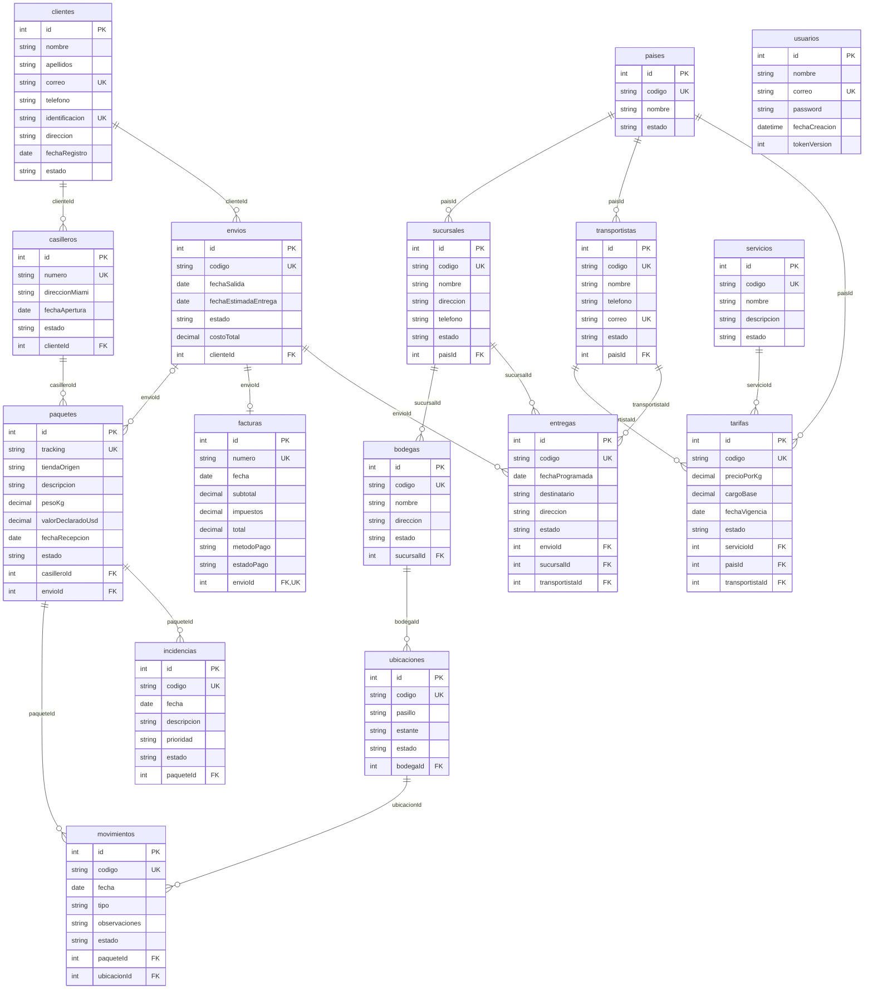

# Modelo de datos Aerolink — 16 entidades

MySQL es la persistencia activa; SQLite se reserva para pruebas aisladas.

## clientes

Contactos e identificación del cliente.

| Atributo | Tipo | Restricciones | Descripción |
|---|---|---|---|
| id | INTEGER | PK, NOT NULL | Identificador autoincremental |
| nombre | VARCHAR(255) | NOT NULL | Nombre descriptivo |
| apellidos | VARCHAR(255) | NOT NULL | Apellidos del cliente |
| correo | VARCHAR(255) | NOT NULL, UNIQUE | Correo válido y único |
| telefono | VARCHAR(255) | NOT NULL | Teléfono de contacto |
| identificacion | VARCHAR(255) | NOT NULL, UNIQUE | Identificación única del cliente |
| direccion | VARCHAR(255) | NOT NULL | Dirección física |
| fechaRegistro | DATE | NOT NULL | Fecha de alta del cliente; formato AAAA-MM-DD |
| estado | VARCHAR(255) | NOT NULL | Estado operativo; valores: activo, inactivo |

## casilleros

Casillero virtual asignado al cliente.

| Atributo | Tipo | Restricciones | Descripción |
|---|---|---|---|
| id | INTEGER | PK, NOT NULL | Identificador autoincremental |
| numero | VARCHAR(255) | NOT NULL, UNIQUE | Número único de casillero o factura |
| direccionMiami | VARCHAR(255) | NOT NULL | Dirección de recepción en Miami asignada |
| fechaApertura | DATE | NOT NULL | Fecha de apertura del casillero; formato AAAA-MM-DD |
| estado | VARCHAR(255) | NOT NULL | Estado operativo; valores: activo, inactivo |
| clienteId | INTEGER | FK, NOT NULL | Referencia a clientes |

## envios

Consolidación y traslado de paquetes del cliente.

| Atributo | Tipo | Restricciones | Descripción |
|---|---|---|---|
| id | INTEGER | PK, NOT NULL | Identificador autoincremental |
| codigo | VARCHAR(255) | NOT NULL, UNIQUE | Código único de negocio |
| fechaSalida | DATE | NOT NULL | Fecha de salida planificada; formato AAAA-MM-DD |
| fechaEstimadaEntrega | DATE | NOT NULL | Fecha estimada, igual o posterior a salida; formato AAAA-MM-DD |
| estado | VARCHAR(255) | NOT NULL | Estado operativo; valores: pendiente, en_transito, entregado |
| costoTotal | DECIMAL(12,2) | NOT NULL | Costo acordado del envío en USD; no negativo |
| clienteId | INTEGER | FK, NOT NULL | Referencia a clientes |

## paquetes

Compras recibidas y su trazabilidad.

| Atributo | Tipo | Restricciones | Descripción |
|---|---|---|---|
| id | INTEGER | PK, NOT NULL | Identificador autoincremental |
| tracking | VARCHAR(255) | NOT NULL, UNIQUE | Tracking único de la compra |
| tiendaOrigen | VARCHAR(255) | NOT NULL | Tienda informada al recibir la compra |
| descripcion | VARCHAR(255) | NOT NULL | Descripción del registro |
| pesoKg | DECIMAL(10,3) | NOT NULL | Peso en kg, mínimo 0.001; no negativo |
| valorDeclaradoUsd | DECIMAL(12,2) | NOT NULL | Valor declarado en USD; no negativo |
| fechaRecepcion | DATE | NOT NULL | Fecha de recepción; formato AAAA-MM-DD |
| estado | VARCHAR(255) | NOT NULL | Estado operativo; valores: recibido, en_bodega, en_transito, entregado |
| casilleroId | INTEGER | FK, NOT NULL | Referencia a casilleros |
| envioId | INTEGER | FK, NULL permitido | Referencia a envios |

## facturas

Cobro del envío e información de pago.

| Atributo | Tipo | Restricciones | Descripción |
|---|---|---|---|
| id | INTEGER | PK, NOT NULL | Identificador autoincremental |
| numero | VARCHAR(255) | NOT NULL, UNIQUE | Número único de casillero o factura |
| fecha | DATE | NOT NULL | Fecha del documento o evento; formato AAAA-MM-DD |
| subtotal | DECIMAL(12,2) | NOT NULL | Importe antes de impuestos en USD; no negativo |
| impuestos | DECIMAL(12,2) | NOT NULL | Importe de impuestos en USD; no negativo |
| total | DECIMAL(12,2) | NOT NULL | Subtotal más impuestos en USD; no negativo |
| metodoPago | VARCHAR(255) | NOT NULL | Método de pago registrado; valores: tarjeta, transferencia, efectivo |
| estadoPago | VARCHAR(255) | NOT NULL | Estado del pago de la factura; valores: pendiente, pagado, anulado |
| envioId | INTEGER | FK, NOT NULL, UNIQUE | Referencia a envios |

## paises

Catálogo geográfico de operación y destino.

| Atributo | Tipo | Restricciones | Descripción |
|---|---|---|---|
| id | INTEGER | PK, NOT NULL | Identificador autoincremental |
| codigo | VARCHAR(255) | NOT NULL, UNIQUE | Código único de negocio |
| nombre | VARCHAR(255) | NOT NULL | Nombre descriptivo |
| estado | VARCHAR(255) | NOT NULL | Estado operativo; valores: activo, inactivo |

## sucursales

Oficinas de atención y distribución por país.

| Atributo | Tipo | Restricciones | Descripción |
|---|---|---|---|
| id | INTEGER | PK, NOT NULL | Identificador autoincremental |
| codigo | VARCHAR(255) | NOT NULL, UNIQUE | Código único de negocio |
| nombre | VARCHAR(255) | NOT NULL | Nombre descriptivo |
| direccion | VARCHAR(255) | NOT NULL | Dirección física |
| telefono | VARCHAR(255) | NOT NULL | Teléfono de contacto |
| estado | VARCHAR(255) | NOT NULL | Estado operativo; valores: activo, inactivo |
| paisId | INTEGER | FK, NOT NULL | Referencia a paises |

## bodegas

Almacenes físicos de una sucursal.

| Atributo | Tipo | Restricciones | Descripción |
|---|---|---|---|
| id | INTEGER | PK, NOT NULL | Identificador autoincremental |
| codigo | VARCHAR(255) | NOT NULL, UNIQUE | Código único de negocio |
| nombre | VARCHAR(255) | NOT NULL | Nombre descriptivo |
| direccion | VARCHAR(255) | NOT NULL | Dirección física |
| estado | VARCHAR(255) | NOT NULL | Estado operativo; valores: activo, inactivo |
| sucursalId | INTEGER | FK, NOT NULL | Referencia a sucursales |

## ubicaciones

Pasillos y estantes identificables dentro de una bodega.

| Atributo | Tipo | Restricciones | Descripción |
|---|---|---|---|
| id | INTEGER | PK, NOT NULL | Identificador autoincremental |
| codigo | VARCHAR(255) | NOT NULL, UNIQUE | Código único de negocio |
| pasillo | VARCHAR(255) | NOT NULL | Identificación del pasillo |
| estante | VARCHAR(255) | NOT NULL | Identificación del estante |
| estado | VARCHAR(255) | NOT NULL | Estado operativo; valores: disponible, bloqueada |
| bodegaId | INTEGER | FK, NOT NULL | Referencia a bodegas |

## transportistas

Proveedores de transporte con país de operación.

| Atributo | Tipo | Restricciones | Descripción |
|---|---|---|---|
| id | INTEGER | PK, NOT NULL | Identificador autoincremental |
| codigo | VARCHAR(255) | NOT NULL, UNIQUE | Código único de negocio |
| nombre | VARCHAR(255) | NOT NULL | Nombre descriptivo |
| telefono | VARCHAR(255) | NOT NULL | Teléfono de contacto |
| correo | VARCHAR(255) | NOT NULL, UNIQUE | Correo válido y único |
| estado | VARCHAR(255) | NOT NULL | Estado operativo; valores: activo, inactivo |
| paisId | INTEGER | FK, NOT NULL | Referencia a paises |

## servicios

Modalidades comerciales de distribución.

| Atributo | Tipo | Restricciones | Descripción |
|---|---|---|---|
| id | INTEGER | PK, NOT NULL | Identificador autoincremental |
| codigo | VARCHAR(255) | NOT NULL, UNIQUE | Código único de negocio |
| nombre | VARCHAR(255) | NOT NULL | Nombre descriptivo |
| descripcion | VARCHAR(255) | NOT NULL | Descripción del registro |
| estado | VARCHAR(255) | NOT NULL | Estado operativo; valores: activo, inactivo |

## tarifas

Precio base y por kilogramo de un servicio, destino y transportista.

| Atributo | Tipo | Restricciones | Descripción |
|---|---|---|---|
| id | INTEGER | PK, NOT NULL | Identificador autoincremental |
| codigo | VARCHAR(255) | NOT NULL, UNIQUE | Código único de negocio |
| precioPorKg | DECIMAL(12,2) | NOT NULL | Precio en USD por kilogramo; no negativo |
| cargoBase | DECIMAL(12,2) | NOT NULL | Cargo fijo en USD; no negativo |
| fechaVigencia | DATE | NOT NULL | Inicio de vigencia de la tarifa; formato AAAA-MM-DD |
| estado | VARCHAR(255) | NOT NULL | Estado operativo; valores: activo, inactivo |
| servicioId | INTEGER | FK, NOT NULL | Referencia a servicios |
| paisId | INTEGER | FK, NOT NULL | Referencia a paises |
| transportistaId | INTEGER | FK, NOT NULL | Referencia a transportistas |

## movimientos

Registro de entrada, traslado o salida de un paquete en una ubicación.

| Atributo | Tipo | Restricciones | Descripción |
|---|---|---|---|
| id | INTEGER | PK, NOT NULL | Identificador autoincremental |
| codigo | VARCHAR(255) | NOT NULL, UNIQUE | Código único de negocio |
| fecha | DATE | NOT NULL | Fecha del documento o evento; formato AAAA-MM-DD |
| tipo | VARCHAR(255) | NOT NULL | Clase de movimiento; valores: entrada, traslado, salida |
| observaciones | VARCHAR(255) | NOT NULL | Detalle del movimiento |
| estado | VARCHAR(255) | NOT NULL | Estado operativo; valores: registrado, anulado |
| paqueteId | INTEGER | FK, NOT NULL | Referencia a paquetes |
| ubicacionId | INTEGER | FK, NOT NULL | Referencia a ubicaciones |

## entregas

Intentos de entrega de un envío coordinados por sucursal y transportista.

| Atributo | Tipo | Restricciones | Descripción |
|---|---|---|---|
| id | INTEGER | PK, NOT NULL | Identificador autoincremental |
| codigo | VARCHAR(255) | NOT NULL, UNIQUE | Código único de negocio |
| fechaProgramada | DATE | NOT NULL | Fecha prevista para el intento de entrega; formato AAAA-MM-DD |
| destinatario | VARCHAR(255) | NOT NULL | Persona que recibe el envío |
| direccion | VARCHAR(255) | NOT NULL | Dirección física |
| estado | VARCHAR(255) | NOT NULL | Estado operativo; valores: pendiente, en_ruta, entregado, fallido |
| envioId | INTEGER | FK, NOT NULL | Referencia a envios |
| sucursalId | INTEGER | FK, NOT NULL | Referencia a sucursales |
| transportistaId | INTEGER | FK, NOT NULL | Referencia a transportistas |

## incidencias

Problemas y seguimiento asociados a un paquete.

| Atributo | Tipo | Restricciones | Descripción |
|---|---|---|---|
| id | INTEGER | PK, NOT NULL | Identificador autoincremental |
| codigo | VARCHAR(255) | NOT NULL, UNIQUE | Código único de negocio |
| fecha | DATE | NOT NULL | Fecha del documento o evento; formato AAAA-MM-DD |
| descripcion | VARCHAR(255) | NOT NULL | Descripción del registro |
| prioridad | VARCHAR(255) | NOT NULL | Prioridad de atención de la incidencia; valores: baja, media, alta |
| estado | VARCHAR(255) | NOT NULL | Estado operativo; valores: abierta, en_revision, resuelta |
| paqueteId | INTEGER | FK, NOT NULL | Referencia a paquetes |

## Decisiones de diseño

- Cliente tiene varios casilleros y envíos; el paquete pertenece a un casillero y admite un envío opcional antes de consolidarse. La API verifica la propiedad del cliente también al reasignar casilleros o envíos.
- Envío tiene como máximo una factura mediante FK única. Puede esperar facturación; no se obliga a crear ambos registros a la vez.
- País → Sucursal → Bodega → Ubicación representa la estructura física de la operación. No se agregan columnas obligatorias a tablas antiguas: los datos existentes se conservan.
- Los movimientos vinculan paquetes con ubicaciones y permiten registrar entradas, traslados y salidas sucesivas. Son registros administrativos editables en esta fase CRUD: no actualizan automáticamente el estado del paquete ni calculan inventario actual.
- Transportista y Servicio son catálogos independientes. Tarifa relaciona servicio, país de destino y transportista con precio por kilogramo y cargo base; los costos del envío siguen siendo importes acordados, sin aplicar tarifas automáticamente.
- Entrega representa un intento: un envío puede tener varios intentos con fecha, destinatario y estado propios. No cambia automáticamente el estado del envío; esa automatización y la coherencia entre intentos quedan para una fase de flujos operativos.
- Incidencia conserva el problema, prioridad y estado de atención de un paquete. La autenticación se incorpora mediante Usuario según contexto2.md; los roles siguen fuera del alcance.
- TiendaOrigen y direccionMiami se conservan como texto histórico de recepción. Los nuevos catálogos no reemplazan estos datos originales ni introducen referencias implícitas.
- Las FK usan RESTRICT y las eliminaciones con dependencias devuelven 409. Todas las nuevas entidades tienen códigos únicos y estados válidos; son entidades de negocio relacionadas, no tablas de relleno.
- DECIMAL(12,2) representa USD y DECIMAL(10,3) peso en kg. Se validan precisión y rango; MySQL devuelve DECIMAL como texto para preservar precisión y la API convierte valores al comprobar totales. SQLite no garantiza precisión decimal estricta; para cálculos financieros futuros conviene aritmética decimal.
- sync solo crea tablas faltantes; no usa force ni alter. Se requieren migraciones versionadas para cambios futuros en columnas, sin borrar datos existentes.

## usuarios — autenticación (día 2)

| Atributo | Tipo | Restricciones | Descripción |
|---|---|---|---|
| id | INTEGER | PK, NOT NULL, autoincremental | Identificador de cuenta |
| nombre | VARCHAR(255) | NOT NULL | Nombre del usuario |
| correo | VARCHAR(255) | NOT NULL, UNIQUE | Correo válido normalizado a minúsculas |
| password | VARCHAR(255) | NOT NULL | Hash bcrypt con salt y coste 12; nunca se devuelve |
| fechaCreacion | DATETIME | NOT NULL, valor automático | Fecha de creación de la cuenta |
| tokenVersion | INTEGER | NOT NULL, DEFAULT 0 | Versión interna para invalidar tokens; nunca se devuelve |

Usuario es independiente de Cliente: una cuenta permite trabajar con los datos empresariales y no equivale al destinatario de paquetes. Se mantiene sin FK de propiedad porque la práctica excluye roles y permisos por usuario; todos los usuarios autenticados acceden a las mismas entidades. La entidad suma 16 tablas, dentro del intervalo solicitado de 15 a 20.

