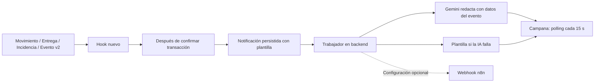

# Agente Aerolink aplicado en el código

Esta integración completa el agente solicitado. No es solo una API key: hay ejecución por eventos, generación de mensajes y un ciclo de herramientas de lectura con Gemini. No necesita n8n para funcionar; n8n queda como salida opcional hacia otros canales.

## Dónde se ve

1. **Campana del encabezado:** contador y panel de notificaciones; consulta cada 15 segundos y permite marcar mensajes como leídos.
2. **Burbuja Asistente IA:** en todas las páginas autenticadas. Conserva la conversación en memoria al cerrar y abrir el widget; se elimina al salir de la sesión o recargar.
3. **Menú Centro del asistente**, ruta `/v2/agente`: chat, selección de aplicación del agente y herramientas de clima, mapa, QR, PDF, CSV y calendario.

Entrar con la cuenta santiago ya vinculada al cliente demo. Para probar: «¿Dónde está mi paquete AER-DEMO-0004?». Las facturas se consultan por cliente; si ese cliente no tiene documentos, el agente debe decirlo, aunque el CRUD administrativo anterior permita consultar documentos de la empresa.

## Agente automático de eventos



Código principal: `backend/src/v2/agents/notificaciones.js`. `backend/server.js` lo inicia automáticamente y registra «Agente Aerolink activo» en consola. Los hooks se agregan en archivos nuevos, sin cambiar los controladores originales.

Los hooks reaccionan a altas y actualizaciones de movimientos, entregas, incidencias y eventos detallados de seguimiento. Se ejecutan después del commit cuando hay transacción; un rollback no genera aviso. Guardan una plantilla antes de llamar a IA. La llamada al proveedor no bloquea el CRUD: sus fallos se aíslan. No se agregan restricciones de borrado a las tablas anteriores.

`notificaciones` es la entidad de negocio número 20. Contiene destinatario cliente/usuario, paquete, tipo, mensaje, leída, fecha y metadatos de procesamiento/deduplicación. Los avisos del cliente se comparten con sus cuentas vinculadas cuando usuarioId es NULL; marcar leído afecta ese aviso compartido. La API muestra los 200 avisos más recientes accesibles y cuenta los no leídos de esa ventana.

El trabajador reclama hasta cinco mensajes por ciclo. Recupera trabajos que quedaron procesando más de cinco minutos. El resumen programado revisa cada minuto y crea como máximo un aviso diario por cliente. Los recordatorios de retiro aplican si el paquete figura en sucursal más de tres días; los de retraso, si supera el extremo superior de su ETA. Se deduplican por día y paquete. Son advertencias estimadas, sin modificar estados ni costos.

Las notificaciones no constituyen una auditoría fiscal ni un registro inmutable. Si el proceso muere exactamente después del commit y antes de persistir el aviso, ese evento podría perderse; no se promete entrega exactamente una vez. Las alertas cuyo paquete ya no pertenece al cliente se excluyen al consultar.

## Chatbot con herramientas reales

Código principal: `backend/src/v2/agents/asistente.js`; adaptador Gemini: `backend/src/v2/integrations/gemini.js`; herramientas: `backend/src/v2/services/herramientas-agente.js`.

El ciclo es: petición JWT → Gemini pide herramienta → Express valida argumentos y cliente vinculado → consulta de lectura → resultado al modelo → respuesta. Se permiten hasta cuatro rondas y cinco herramientas por ronda. El proveedor nunca recibe una conexión SQL ni credenciales de MySQL. Las herramientas no escriben en la BD.

Herramientas implementadas:

- `buscar_paquete`: estado, ubicación y ETA de un tracking propio.
- `historial_movimientos`: movimientos e intentos del envío asociado a un paquete propio.
- `listar_sucursales`: directorio general con horarios y referencias demo.
- `consultar_tarifas`: servicios activos y tarifas registradas de referencia, sin cotización automática.
- `consultar_facturas_cliente`: facturas exclusivamente del cliente vinculado; no acepta clienteId.
- `listar_incidencias`: incidencias de paquetes propios.
- `resumen_operacion`: conteos y pendientes del cliente vinculado, con límites indicados.
- `consultar_clima`: datos reales de Open-Meteo por código de sucursal o ausencia explícita de datos.
- `consultar_calendario`: calendario configurado de Costa Rica.
- `ayuda_aerolink`: instrucciones y límites reales del proyecto.

No se aceptan herramientas arbitrarias, SQL ni IDs de otro cliente en argumentos. Los modos de resumen, facturas, sucursales, tarifas y ayuda precargan sus herramientas antes de redactar. Traducción e incidencia generan borradores para revisión; no guardan ni envían nada. Un fallo de Gemini produce respaldo identificado, nunca una respuesta etiquetada como IA exitosa. Las respuestas llegan completas; no se implementa streaming en esta versión.

## Aplicación de todas las opciones aprobadas

| Opción | Dónde se aplica |
|---|---|
| Estado y ubicación de paquetes | Chat con buscar_paquete y pantalla Rastrear paquete |
| Notificaciones en lenguaje natural | Hooks, tabla, trabajador Gemini y campana |
| Resumen de operación | Modo Resumen de mi operación y herramienta de lectura |
| Resumen diario | Notificación programada por cliente, deduplicada por fecha |
| Ayuda con incidencias | Modo Borrador de incidencia: descripción/categoría orientativa/prioridad; revisión antes de guardar manualmente |
| Explicación de cobros | Modo Explicar cobros y facturas; usa únicamente importes registrados |
| Ayuda de uso | Modo Cómo usar Aerolink y herramienta con flujo real |
| Traducción español/inglés | Modo Traducir, sin ejecutar acciones sobre la traducción |
| Clima | Centro: Consultar clima, o pregunta al agente con código de sucursal |
| Mapa | Centro: Mostrar mapa con referencia urbana aproximada y atribución OSM |
| Etiquetas QR | Centro: Generar QR y descargar PNG; no incluye token |
| Recordatorios de retiro | Agente programado, etapa en_sucursal y antigüedad >3 días |
| Avisos de retraso | Agente programado, rango estimado vencido |
| Feriados | Centro: calendario y ETA alternativa que desplaza fines de semana y feriados configurados |
| CSV | Centro: Mis paquetes CSV; máximo 100 paquetes, con protección de fórmulas |
| PDF | Centro: comprobante administrativo del paquete propio, claramente no fiscal |
| Correo/WhatsApp por n8n | Webhook preparado, desactivado hasta configurar URL/secreto y proveedor/destino externos |

El modelo organiza consultas y redacta explicaciones. QR, CSV y PDF se generan con código determinista y datos autorizados; no se pide a IA que invente esos documentos.

## Endpoints nuevos

Todos bajo `/api/v2`, con autenticación:

| Método y ruta | Función |
|---|---|
| POST /chat | Conversación y modos del agente; límite de 12 consultas/minuto por cuenta |
| GET /notificaciones | Últimos 200 avisos accesibles y contador de no leídos de esa ventana |
| PATCH /notificaciones/:id/leida | Marcar un aviso propio como leído |
| GET /asistente/resumen | Resumen personal de lectura |
| GET /asistente/clima/:codigoSucursal | Clima externo o indisponibilidad explícita |
| GET /asistente/mapa | Sucursales y coordenadas aproximadas disponibles |
| GET /asistente/calendario?anio=2026 | Feriados configurados |
| GET /asistente/estimacion/:tracking | ETA alternativa con ajuste de extremos; no cambia la original |
| GET /asistente/qr/:tracking | PNG en data URL y enlace protegido |
| GET /asistente/exportar/paquetes | Archivo CSV como contenido JSON descargable |
| GET /asistente/pdf/:tracking | PDF en base64 para descargar en el frontend |

El QR abre `/v2/etiqueta/:tracking`, que conserva el código incluso si primero hay que iniciar sesión, y redirige después al rastreador. El botón Rastrear realiza la consulta autorizada.

## Configuración y arranque

La clave Gemini existente permanece exclusivamente en `backend/.env`, ignorado por Git. Variables adicionales documentadas en `.env.example`:

```env
GEMINI_API_KEY=
GEMINI_MODEL=gemini-2.5-flash
GEMINI_TIMEOUT_MS=15000
AGENT_DAILY_ENABLED=true
FRONTEND_URL=http://localhost:5173
N8N_WEBHOOK_URL=
N8N_WEBHOOK_SECRET=
```

Desde la raíz:

```powershell
npm install --prefix backend
npm run migrate:v2
npm run seed:agente:v2
npm start
# Otra terminal:
npm run dev:frontend
```

El seed de agente prepara avisos de eventos demo ya existentes y es repetible. Se asume preparado el seed de sucursales/tracking de fases anteriores. No modifica sus registros. Si falta una vinculación, usar el comando local ya documentado; no hay autoasignación pública de clientes.

### n8n opcional

Configurar un Webhook POST con Header Auth `X-Aerolink-Secret`, el mismo secreto de `N8N_WEBHOOK_SECRET` y su URL de producción en `N8N_WEBHOOK_URL`. Recibe eventoId, clienteId, paqueteId y mensaje. El workflow debe resolver destinatarios autorizados y configurar el nodo de correo o WhatsApp con las credenciales de ese proveedor.

El webhook no recibe JWT del usuario, clave Gemini, contraseña MySQL ni acceso directo a herramientas del chatbot. Debe deduplicar por eventoId. La entrega externa es de mejor esfuerzo, con timeout; no se promete reenvío persistente ni confirmación de recepción. No se ha configurado ni enviado correo/WhatsApp en esta sesión porque faltan esos destinos y credenciales.

## Datos externos y límites

- Gemini genera lenguaje; no se garantiza que nunca cometa errores. La UI identifica el origen y los borradores requieren revisión humana.
- Open-Meteo se consulta con coordenadas de centros urbanos demo, no direcciones de clientes, con caché de 15 minutos. No cambia la ETA. Su API gratuita está destinada a uso no comercial; revisar licencia antes de producción. [Open-Meteo](https://open-meteo.com/en/pricing).
- El mapa muestra referencias urbanas aproximadas de oficinas demo, no ubicaciones exactas verificadas. [OpenStreetMap](https://www.openstreetmap.org/copyright).
- El calendario incluye los 12 días configurados de Costa Rica para 2026, contrastados con el [calendario MTSS](https://www.mtss.go.cr/temas-laborales/feriados/feriados_calendario_2026.pdf). Otros años se informan como no configurados. No representa horarios comerciales ni asesoría laboral. La ETA alternativa mueve solo extremos a un día laborable; no recalcula todo el trayecto ni afecta el endpoint de tracking previo.
- Los límites de lectura son explícitos: 100 paquetes y hasta 500 envíos/facturas en resumen, 100 facturas/incidencias, 30 sucursales/tarifas/servicios y 50 eventos en historial del agente.
- Los CRUD administrativos originales conservan su acceso global para autenticados. El aislamiento por cliente se aplica al agente, seguimiento, notificaciones y exportaciones personales v2.
- El proceso es local y único. No se declara arquitectura distribuida ni entrega garantizada de mensajes externos.

## Evidencia de pruebas

- Suites originales de backend y autenticación aprobadas.
- 233 peticiones de CRUD MySQL aprobadas para las 16 entidades originales.
- Pruebas v2 aprobadas: hooks después de commit, rollback sin alerta, respaldo si IA falla, ciclo tool calling simulado, argumentos prohibidos, privacidad de avisos, lectura, CSV, QR, cabecera PDF y calendario.
- Prueba real Gemini: pidió buscar_paquete, consultó AER-DEMO-0004 y respondió etapa en aduana y ETA estimada.
- Tres notificaciones demo generadas realmente con Gemini.
- Consulta real de clima de Heredia devolvió datos Open-Meteo.
- Flujo real HTTP: crear movimiento 201 → hook persistió notificación → API de campana 200. El registro temporal se eliminó sin nuevas restricciones de borrado.
- 30 pruebas React y build de producción aprobados, incluida conversación persistente al cerrar widget, modos, lectura de campana y herramientas.
- Colección previa: 168 peticiones y aserciones aprobadas.
- No se pudo realizar revisión visual en un navegador completo; las pruebas de UI usan DOM simulado.

## Validación manual

- [ ] Iniciar sesión como santiago y ver campana, burbuja IA y menú Centro del asistente.
- [ ] Preguntar por AER-DEMO-0004 y comprobar etiqueta Gemini y herramienta buscar_paquete.
- [ ] Preguntar por un paquete ajeno y comprobar ausencia de datos.
- [ ] Probar Mis facturas y Resumen; si no hay facturas propias, no inventar documentos.
- [ ] Generar borrador de incidencia y traducción; comprobar que no se guardan registros automáticamente.
- [ ] Crear/editar una incidencia por el CRUD anterior y observar la campana después del procesamiento.
- [ ] Marcar aviso leído y comprobar contador.
- [ ] Ver clima de Heredia, abrir mapa, generar QR y descargar PDF/CSV de un tracking propio.
- [ ] Abrir el QR sin sesión, iniciar sesión y comprobar que conserva el código.
- [ ] Consultar calendario y ETA alternativa sin que cambie la ETA original.
- [ ] Desconectar Gemini y confirmar respaldo y CRUD funcionales.
- [ ] Repetir login y los CRUD anteriores, incluido rechazo 409 al borrar dependencias.
